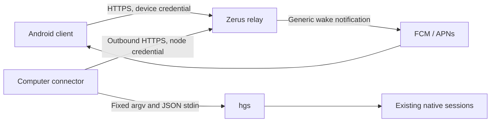

# Mobile architecture

Status: Android app, protocol version 1; a native iOS client with the same
safety rules is in development in `mobile/ios`. The clients,
relay and computer connector live in this repository under the MIT license,
except for attributed Apache-2.0 terminal adaptations from MuxPod. Their source
headers identify the upstream revision, and the APK and the iOS app include the
complete license (`assets/licenses/mux-pod.txt` and
`mobile/ios/Zerus/Licenses/mux-pod.txt`).
The existing `hgs` CLI remains the authority for native session identity and input.

## Product boundary

The Android client connects to existing computers, browses logical projects and
sessions, and operates native session workflows: conversations and attachments,
questions, queues, model settings, context, lifecycle actions, process output,
session creation and supported terminals. It preserves private drafts, reading
positions and uncertain delivery receipts. Native capabilities determine which
actions are available for each adapter and running version.

Account enrollment, project catalog administration, desktop filesystem windows
and global recovery policy remain native or desktop setup tasks. Mobile recovery
controls operate individual already-scheduled jobs. iOS can use the same HTTP
protocol later; no Android-specific object is required to operate a session.

## Connection model



Both clients initiate outbound connections to one configurable HTTPS origin.
The computer publishes snapshots and long-polls a command queue. The phone
reads snapshots and submits typed requests. No inbound port, public SSH access,
VPN enrollment or mobile copy of computer credentials is required.

Nebula remains useful for a private relay address or existing desktop peers.
Requiring it on every phone would add VPN provisioning and would not solve
Android background wake delivery. The mobile protocol therefore treats Nebula
as an optional network, independent of pairing and push.

HTTP long polling is used for commands and events. It works through ordinary
HTTPS reverse proxies and provides explicit durable claim semantics. It can
later be replaced with a WebSocket transport without changing command identity.

### Sharing boundary: paired computer and direct peers

The connector exposes an explicitly connected gateway computer and its enabled,
directly configured Zerus peers. The relay keeps the gateway credential separate
from the computers reachable through it.

For example, connecting a phone to computer A should expose A and its direct
peer B. B's connection to C must not expose C through A. Extending access requires
explicitly connecting B or another gateway. A computer appearing as a neighbor
does not itself become an authorized gateway. Multiple explicit connections
expose the union of their individual one-hop neighborhoods, never the transitive
closure of the machine graph. Arbitrary SSH aliases and shared-catalog entries
do not establish a sharing edge.

An explicit gateway connection means owner-authorized connector enrollment in
the workspace. A gateway credential may also invite, list and revoke the phones of
its workspace (owner decision, 2026-10-17): every computer shows the phones, the
computer whose invitation each one used and a revoke action, so a phone added
through one gateway, which reaches every computer of the workspace, stays
visible. `platform` follows the push registration (`ios` for APNs, `android` for
FCM, otherwise `null`); `paired_at`, `last_seen_at` and `added_by` are `null` for
phones paired before the relay recorded them. Peers manage phones through their
gateway with `hgs @gateway mobile`, never with a credential of their own. Existing device credentials remain workspace-scoped; this design
does not introduce phone-specific gateway grants. Discovering a neighbor must
never create a connector credential or enroll that neighbor as a gateway.

Discovery, publication and command dispatch must all enforce this same boundary.
The phone cannot supply a multi-hop route or increase discovery depth. A gateway
may execute locally or forward once to a verified direct peer; that peer must
execute locally. SSH credentials remain on their owning computers. Removing a
configured edge or disconnecting a gateway removes the routes depending on it.
Other independently authorized routes remain valid; an explicit computer-level
revocation blocks every route to that computer.

Peer traffic follows the enrolled gateway: phone → relay → gateway → direct
peer, with the reply returning through the same gateway. Pairing Arch therefore
allows access to its configured Mac through Arch; it does not connect the phone
directly to Mac. If Arch is unavailable, its route to Mac is unavailable too.

Stable computer identity is separate from the route used to reach it. A machine
reachable both directly and through another authorized gateway appears once,
with its sessions and drafts preserved. Each submitted request retains its
original target and selected route; claimed or uncertain mutations never move
automatically to another route.

#### One-hop implementation contract

The existing phone API remains unchanged: `GET /v1/computers` returns computers
and `POST /v1/requests` accepts the selected `computer_id`. A relay node is an
authenticated gateway queue consumer. A discovered peer is a computer and a
route, never a node credential or an additional gateway enrollment. Deduplication
is scoped to one authorized workspace; identical native UUIDs in different
workspaces do not combine their authorization domains.

The relay keeps a computer registry and gateway routes separately from node
credentials. Existing node IDs remain valid computer IDs. The first persisted
binding of a native machine UUID chooses its canonical computer ID; subsequent
routes attach to that computer. A newly discovered peer matching an existing
bound local computer does not create another computer. A newly enrolled gateway
for an already visible peer attaches its direct route before first publication.
Historical request bodies and hashes are never rewritten. Legacy IDs remain
accepted lookup aliases. If two different legacy IDs were already published
before their shared native identity becomes known, keep their presentation rows
until an alias-aware client migration can preserve drafts, caches and outboxes;
an old client must not silently lose the computer row referenced by a draft.

The gateway heartbeat has this additive shape:

```json
{
  "snapshot": {"sessions": []},
  "machine_id": "00000000-0000-4000-8000-000000000001",
  "peers": [{
    "route_id": "00000000-0000-4000-8000-000000000002",
    "machine_id": "00000000-0000-4000-8000-000000000003",
    "name": "Example peer",
    "online": true
  }]
}
```

`POST /v1/node/heartbeat` still requires only `snapshot`; `machine_id` and
`peers` are additive. A native UUID binding cannot silently change. `peers` is
an authoritative manifest of at most 32 direct routes; omission withdraws old
peer routes while preserving legacy local behavior. Missing `machine_id` does
not erase an established local binding. The connector generates stable opaque
route UUIDs from its local alias and the pinned target UUID. SSH aliases, host
settings and credentials are not sent to the relay or phone.

Publish each peer separately through
`POST /v1/node/peers/{route_id}/heartbeat`, with body
`{"machine_id":"<native UUID>","snapshot":{"sessions":[]}}`.
The authenticated gateway must already advertise that exact route/UUID pair in
its current manifest. Updating it does not enroll a gateway. Each peer has its
own observation time: fresh Arch heartbeats cannot keep stale Mac data online.
A withdrawn or explicitly offline route becomes unavailable immediately. An
offline route stays listed beneath its gateway with `online: false` and no
snapshot, so its computer ID, phone label and color remain stable, but it cannot
be selected, claimed or receive a peer snapshot. Its `last_seen_at` keeps the
time of the last accepted peer heartbeat, or null if the relay never observed
that native UUID on the route, so phones can show when it was last seen. Gateway
heartbeats never refresh that time, and a changed native UUID starts a new route
without it. After reconnection the route needs a fresh peer observation before
it becomes usable, however recent the retained time is. Existing
body, response and workspace resource limits continue to apply; peer count does
not multiply the permitted size of an individual request or computer response.
Peer snapshot storage is capped at 1 MiB of canonical JSON, as is the connector's
heartbeat envelope. The workspace registry retains at most 2,048 computers,
4,096 aliases and 4,096 routes, including revoked identities. Admission rejects
new registry entries at these bounds rather than dropping revocation records or
request receipts. The combined phone catalog keeps its existing 1 MiB response
budget and checks selected snapshot sizes before loading them.

Computer rows retain `id`, `name`, `online`, `last_seen_at` and `snapshot`.
Additive metadata may include `machine_id`, `aliases` and
`via: {"gateway_id":"<node ID>","gateway_name":"Example gateway"}`;
`via` is null for a direct route. Old phones can consume the normal computer
rows without understanding the additional metadata. Prefer a fresh direct
route, then a fresh peer route ordered deterministically by gateway and route
ID. Capabilities and displayed snapshot must come from the selected route.

New gateways advertise the `gateway_one_hop` feature. At submission, store the
target computer/native UUID and selected route alongside
the request; `requests.node_id` remains its committed gateway. Remote claims add
`gateway_route: {"schema":1,"route_id":"<UUID>","computer_id":"<ID>",
"machine_id":"<native UUID>"}`. New bound local claims include the same envelope
with `route_id: null`, so their execution also verifies the persisted target UUID.
Historical unbound claims keep their existing shape and fingerprint. Guarded
claims cannot be delivered to a downgraded gateway lacking this capability.
Each queue poll must explicitly include `gateway_one_hop=1`; a stored heartbeat
feature alone is insufficient because an older connector may start before its
first heartbeat replaces the previous version's capabilities. Without this
per-poll opt-in, guarded local and peer requests remain unclaimed.
Duplicate submissions return the preserved receipt before checking current route
availability; losing a route does not invalidate a request's durable identity.
Before claiming a queued remote request, recheck its
frozen route; if withdrawn, fail it before delivery rather than choosing another
route. Once claimed, delivery loss remains uncertain and cannot cause requeue
or automatic replay. Result authorization remains bound to the original gateway.
Withdrawal atomically fails queued requests for that route. Re-adding the same
alias/native UUID and deterministic route ID cannot revive those requests;
only a new request UUID can use the restored route. Claim and withdrawal must
serialize their route checks and state transitions. Already executing native
operations cannot be retroactively cancelled by withdrawing a route.

The native ABI consists of `hgs mobile-peers --json` and
`hgs mobile-peer --json`. Discovery returns schema 1, a local
`{machine_id,name}` object, and direct peer rows containing
`{via,machine_id,name,online,error,identity}`; `via` is a configured alias
retained only on the gateway. A reachable peer has `identity: "verified"`. An
unreachable peer is `online: false` with the UUID and name this gateway last
verified through the same alias (`identity: "last_verified"`), or with
`machine_id: null` and `identity: null` when none exists. The gateway records its
own successful probes per enabled direct alias in private
`swarm/mobile-peers.json`, bound to its local machine UUID: removing or disabling
an alias forgets it, a changed verified UUID replaces it, and a copied or reset
configuration inherits nothing. Without such a record, a binding pinned by this
machine's own `swarm hello` or `export` through that alias may supply the UUID.
Shared catalog data, including machine names, redirects and `swarm get` machine
rows, is replicated from other members and is never identity evidence. A
remembered identity only presents an offline route and never authorizes
dispatch. The connector advertises such a row as an offline route and omits
identity-less rows; a changed UUID yields a new route ID and withdraws the old
one. Discovery does not inspect neighbors. The dispatch stdin envelope is
`{schema:1,via,target_machine_id,argv,payload}`. It resolves `via` against the
currently enabled local configuration, then invokes the fixed remote
`hgs swarm __mobile-peer-local --json` entrypoint with only
`{schema:1,target_machine_id,argv,payload}`. The destination verifies its own
persistent UUID in the same executing invocation and performs an allowlisted
local operation. It rejects forwarding fields, `@host` routing and arbitrary
commands. Native stdout and exit status remain compatible with existing
connector calls, including JSON inspection and textual capability discovery.
For a bound local target, the connector calls `swarm __mobile-peer-local` locally
with the expected UUID, rather than bypassing its guard. Copying a gateway
configuration or resetting native machine identity must not execute a previously
bound request on a different machine. Discovery may use a fixed private
`swarm __mobile-peer-identity --json` helper returning only native UUID and name.
Production connector calls use `hgs swarm mobile-peers --json` and
`hgs swarm mobile-peer --json`. The existing `swarm` namespace rejects unknown
subcommands on older binaries. This remains safe when a binary is downgraded
between capability discovery and execution; an unknown top-level command could
otherwise enter the generic session launcher. Help requests never execute work.

The connector maintains separate session/archive membership, capabilities,
attention, project and account contexts for each machine. Peer calls use the
guarded native dispatch callback; all contexts share the original durable
connector journal, whose request fingerprint includes the immutable route
envelope for new remote work. Resolving a route never accepts an SSH alias from
a phone or relay. The native dispatcher rechecks the enabled edge immediately
before forwarding, so stale relay inventory cannot authorize a removed peer.
Bound peer fanout, subprocess output and deadlines independently of the fixed
one-hop rule, and keep local heartbeats independent of slow remote probes.
Fanout workers run concurrently but spawn transport processes one at a time: on
macOS a concurrently spawned child could inherit another peer's pipes and stall
that peer until it exits.
Computer-level revocation covers every route and preserved legacy presentation
alias for that native identity within its workspace. Revoking a gateway removes
its routes only; it does not revoke independently authorized routes elsewhere.
Computer revocation does not revoke a gateway credential on that same machine:
the revoked computer is hidden and cannot be targeted, while its enrolled
connector can still reach other authorized peers. Revoke the node credential to
disable that gateway and all routes depending on it.

## Trust and authorization

Version 1 trusts the selected relay operator with session metadata, messages and
answers in transit through the relay and in its bounded request store. TLS
protects the two network connections; this is **not end-to-end encryption**.
Use a relay you administer for confidential workloads. End-to-end encryption
with computer keys verified during pairing is a prerequisite to promising a
cloud service that cannot read customer content.

An administrator provisions workspaces and computers through the relay's local
CLI. There is no public account registration or HTTP administrative endpoint.
A phone consumes a random, single-use, short-lived invitation, then receives its
own revocable device credential. Computer and phone credentials are separate,
random capabilities; the server stores their hashes. Every lookup includes the
authenticated workspace, and request results are restricted to their requesting
device. A computer can only claim work assigned to its own identity.

Android stores the credential using Android Keystore encryption and disables
application backup. Connector credentials, server push credentials, databases
and signing keys belong in private local configuration, outside source control.
Production clients require HTTPS. Any emulator loopback exception is explicitly
limited to development.

### Encrypted relay transport

Owner-approved boundary, 2026-10-23 (`zerus-45e.6`, enrollment in
`zerus-45e.8`): the relay must not be able to read private payloads. Routing and
delivery metadata remain visible so the relay can provide durable queues,
offline storage, admission limits, service priorities and push delivery. This
section defines the API v2 boundary implemented in this source tree. The
[workspace specification](encrypted-workspaces.md) describes enrollment,
persistence, switching and the security verification map; the
[wire specification](../services/mobile/crypto/README.md) defines exact bytes.
API v1 connections described above still trust the relay with plaintext content.
Public enrollment remains an explicit server configuration.

| Encrypted between trusted devices | Visible to the relay when needed |
| --- | --- |
| Messages, answers, approval disclosures and command arguments | Opaque workspace, device, gateway, route and request identifiers |
| Session/project names, paths, account details, histories and terminal/process output | Protocol version, operation class, delivery state, expiry, payload size and timing |
| Files, attachments, recordings and transcription content | Server-assigned service class, quotas and cryptographic envelope metadata |
| Detailed snapshots, results and native error text | Bounded activity/presence and notification hints without private text |

An executable command line or filesystem path is private content, even when it
describes a process. Only the routing and bounded operational metadata needed
for the service belong in the visible envelope. Notifications may disclose a
generic category such as attention needed; session names and message excerpts
stay encrypted. The exact visible fields require a versioned allowlist.

The relay retains authentication, routing, durable claim/receipt storage,
pagination, retention, byte accounting and rate/concurrency limits. It stores
encrypted payloads while recipients are offline. Notification and presence
rules use explicit bounded hints rather than inspecting private snapshots.
The team's highest service class is assigned by operator-controlled server
policy and does not grant access to another workspace's payloads or keys.

Endpoints decrypt and validate private content, verify the cryptographic
sender's membership and role, and perform the existing native target, run,
conversation and question checks. A relay-issued bearer token alone must not
authorize an unrecognized cryptographic sender. Service hints are not evidence
that native work completed: clients require an authenticated endpoint result.
Outer operation/resource hints must not weaken durable identity retention;
mislabeling an encrypted mutation as a read must never permit its execution
again after relay cleanup.

Each device generates and retains its private keys locally. Verified enrollment
binds device keys and workspace membership using an existing trusted device.
Create workspace, Join by code and Change workspace remain the enrollment
model; an unconfigured machine is not assigned a workspace automatically.
Phone and computer invitations have separate purposes. Their secret
verification material is generated on a trusted device and conveyed through
the copied code or QR, without revealing it to the relay. The relay may hold
public lookup identifiers and separate service authorization records. A key
directory controlled only by the relay is insufficient to prevent key
substitution. Lost local state uses a new invitation from a remaining trusted
device; no account/password recovery service is introduced.

The protocol must bind payloads to their authenticated sender, workspace,
intended gateway/target, request identity and applicable key generation. A relay
must not be able to substitute an executor, change a command or forge its
result. Retain exact request identities and durable no-replay journals across
reconnection, ciphertext redelivery, crashes and key changes. Encryption state
and outgoing payload persistence must prevent nonce/state reuse or silently
creating a new operation after an uncertain submission. Existing API v1 hashes
and receipts are not rewritten.

Removal or a workspace change must update cryptographic authorization as well
as relay credentials. Once the required membership/key update is accepted,
removed devices must not decrypt future private payloads. Previously received
plaintext cannot be recalled. Switching workspaces keeps their keys and journals
separate and preserves local native sessions and desktop project state.

The initial confidentiality boundary follows the existing trusted gateway:
phone to gateway through the relay, then the gateway's existing SSH connection
to a direct peer. That gateway can read the content it executes or forwards.
Direct peers do not become independently enrolled gateways merely to enable
this protection. Hiding content from an intermediate gateway would require a
separate target-device cryptographic endpoint and is outside this initial scope.

The selected single-shot HPKE/Ed25519 format uses separate per-recipient
envelopes and a signed membership log. It does not provide MLS group forward
secrecy, post-compromise recovery or global consensus against a malicious relay.
Protected connections never silently fall back to plaintext. Legacy v1
compatibility does not make historical plaintext or backups encrypted
retroactively.

## Delivery safety

1. The phone creates a UUID and durably records the exact draft and target before
   submitting an action. It includes the displayed run and conversation identity;
   question replies also include the exact question ID and fingerprint.
2. The relay records the request before acknowledgement. Reusing its UUID with
   the identical body returns the existing request; changing its body is rejected.
3. Claiming a command is a durable transition. Claimed commands are never put
   back into the queue after disconnection or restart. Old queued commands expire.
4. The connector journals the attempt before invoking a fixed allowlist of `hgs`
   commands. It does not invoke a transport shell or infer a different session
   after the requested session disappears. Explicit Terminal input is delivered
   to the verified existing native pane, which may itself contain a shell.
5. `hgs` verifies the current native identity and its existing input preconditions.
   Successful submission means delivery to the native interface, not a model reply.
6. A timeout or crash after a mutation might have started produces an uncertain
   result. The phone retains its draft and receipt, and requires deliberate review
   before a new attempt. Neither relay nor connector automatically resends it.

Read refreshes can issue new request IDs. Retrying an acknowledged result upload
does not execute the native command again. The connector never restarts native
agents, tmux servers or DeepSeek hosts.

The Android composer and outgoing messages have separate durable state. Sending
atomically moves the current composition into an outgoing envelope before any
network request. The conversation immediately shows its delivery status while a
new composition can be edited. Completion never clears a later draft. Unknown
delivery remains visible and cannot trigger an automatic resend.

Automatic read progress appears only after five seconds of continuous waiting.
Explicit refresh shows progress immediately, including when it promotes an
already-running read. Operation and navigation identities prevent an old
session's response from replacing the current session or hiding its progress.
Catalog and conversation reads share their existing progress state with a thin
top bar; pull-to-refresh keeps its circular indicator. A conversation's pull
starts past its newest message, so its indicator rises from the bottom. Background reads retain
the same five-second delay and do not start an extra request for either indicator.

## Projects and attachments

The connector reads the canonical logical project catalog with `hgs swarm get`,
separately from the legacy directory aliases in `hgs ls`. The additive
`snapshot.mobile_projects` object contains stable project IDs, names, colors,
the default project, and this computer's folders and exact session membership.
It excludes peer connection settings and synchronization history. Catalog reads
are cached for fifteen seconds; a temporary failure marks the previous catalog
stale instead of discarding it. Android scopes project identity to the paired
workspace, native swarm and project ID, and retains projects with no sessions.

Sessions is the initial Android view. Its desktop-derived filters select all
nonarchived sessions, sessions needing attention, active sessions, saved
sessions, or archives. Machine selection includes the workspace identity.
Active replaces Working and combines current work with sessions needing
attention, counting each session once. Explicit review-later reminders remain
active offline; cached work and input states alone do not.
Filtering and search produce project groups containing only matching sessions;
the separate Projects catalog includes empty canonical projects. Both keep the
order in which `hgs swarm get` lists the projects, the swarm's shared order. Directory
fallback groups remain confined to the session list. Provider badges and filter
glyphs reuse the desktop drawing geometry.

`SessionCardPresentation` ports the desktop card rules from
`SessionPresentation.h` and the session tree in `SessionsWindow.cpp`. The
checkout line is `checkoutLine`: `checkoutFolder` (a linked worktree's main
checkout from `git_common_dir`) and `branchContext` (branch or detached HEAD,
none for `not_repo`), with the desktop Git branch glyph, or the folder glyph for
an ordinary folder. `checkout` adds the `projectContext` worktree mark for
headers and Details; the spoken description keeps the worktree's own folder. The counter is
`childCount` without completed children. Rows come only from the snapshot
`subagents` roster, never previews, and never for `hook_profiles`. They use
`childStatus`, `Recorded` without current activity, and the `showChild`
visibility rules. Attention counting stays in `SessionFilters`. Expanded cards
are kept per exact target in the ViewModel. A child row first opens its parent.
The ViewModel binds the request to that navigation, run and conversation for 30
seconds. After the first verified parent presentation, `inspectAgent` rechecks
the roster and capabilities. A changed conversation, an expired request or a
missing child reports an error without retrying.

[Telegram's chat behavior](https://github.com/DrKLO/Telegram/blob/master/TMessagesProj/src/main/java/org/telegram/ui/ChatActivity.java)
is a design reference for read positions, unread boundaries, paging and
jump-to-latest controls. Its GPL source is not copied into this client.

Session badges use the desktop semantic palette: working is green, ready is
neutral, input and approval are yellow, errors are pink, and paused is purple.
Inactive rows use neutral badges unless an explicit unread or review-later
marker applies. Labels accompany colors, and attention takes precedence over
routine work.

List previews normalize known native question-response envelopes for display
only. Complete responses show their answers. Native list summaries may already
be truncated; a complete leading answer string can still provide a readable
snippet, while an incomplete value uses a generic question-response label.
Embedded examples, unknown tags and ordinary code remain literal. Preview
formatting never changes raw messages, receipt matching or conversation identity.

Archive inspection carries an explicit `archive_id` in the inspect payload.
The connector checks the exact session-name/UUID pair against a recent local
snapshot and invokes `hgs inspect SESSION --archive UUID`. Both ends verify the
returned archive identity. Live inspection rejects archived results, including
when a same-named live session disappears. Archived conversation content is
read-only; restore, rename, fork and forget remain explicit capability-gated
lifecycle actions. Archive target keys cannot collide with live drafts or
outgoing messages. Archive
rows do not participate in live notification transition detection.

### Native context and prompt cache

Context diagnostics come from the same native inspection as the desktop UI.
`session_usage.context` supplies used tokens, the reported window and any
estimate marker. Missing values remain unknown; the client never guesses a
window from a model name. The desktop's 70% and 90% colors indicate growing
context pressure, not proof that native compaction is required.

Provider prompt cache is separate from the phone's saved conversation history.
Native cold-cache hints override a reported warm cache; an elapsed native TTL
is shown as an estimated expiry. Cache-read tokens from the last request do not
prove that a cache is still warm. A saving suggestion does not prove it is cold.
Archived or cached inspections explicitly remain last-known data.

Submitting a native question answer with a cold or expired prompt cache requires
an explicit **Submit full context** or **Cancel** choice. The warning explains
that the provider may process the full conversation again, increasing token use
or cost. This same guard covers Other answers, approval decisions after their
existing review countdown, and Skip. It never offers clear or compact while an
answer is pending: those operations would invalidate the pending answer.
Cancel preserves the complete saved form without allocating a delivery request
or changing its status.

The ViewModel retains the confirmation outside recycled question cards across
rotation. It pins the exact computer/session/run/conversation, navigation,
question ID/hash/tool/source/schema, literal answer payload, and draft
generation/revision/raw form state. Confirm revalidates current native capability,
verified inspection and that unchanged snapshot before one delivery can begin;
changed or unavailable evidence cannot release transport. Consent is never
persisted or reconstructed after process restart, while the ordinary encrypted
question draft remains recoverable. Direct calls to the common answer method
cannot bypass the cold-cache guard. If a warm cache expires while saving the
prepared answer, transport is refused with a visible question notice. The exact
original editing form is restored only while its prepared request and revision
remain owned; a concurrent edit is preserved. This refusal never opens a new
confirmation or retries input automatically.

Android context details offer a separate **Dismiss and clear…** confirmation
only when both relay and exact computer advertise `clear_context_dismiss` and
the selected fresh native inspection reports actual Boolean eligibility. The
dialog captures its mode and target; it never upgrades an ordinary clear
confirmation automatically. The explicit mode stores `dismiss_prompt:true` in
the original durable context operation and rechecks identity, capabilities,
eligibility and other pending work before transport. Only its own reservation
is excluded from that final pending-work check. Ordinary clear omits the field;
strict decoding preserves actual `false`/`true` metadata and rejects malformed
new fields through the existing storage failure path without overwriting data.
Receipt checking, recovery and review retain the original identity and never
authorize replay. Cold-cache consent and draft/attachment handling are unchanged.

Compact and clear are fixed native operations scoped to the exact computer,
session, run, conversation and request UUID. The phone saves an operation before
transport, and uncertain delivery is checked without replaying the mutation.
Clear requires confirmation naming its session and computer and preserves the
unsent draft. Moving that draft to a new conversation is restricted to an
active, confirmed clear in the same run; ambiguous or recovered operations keep
the original draft available for explicit restoration.

Compact and continue retains a cancellable send intent only in memory. It waits
for the matching native compaction request to complete and the agent to be idle,
then sends only the original unchanged draft with its native compaction UUID.
An edit, attachment change, navigation, restart, cancellation, failed or unchanged
compaction, or identity change cancels that continuation. A later prompt,
interruption, permission request or session end also ends it; a compaction that
already completed keeps its Completed result. Acceptance of the
compact command alone is never completion. Clear and compact never run merely
because context is large or a cache has expired.

### Session controls and native details

The session header exposes the native model and effort catalog. A settings
change made during a busy turn can be scheduled by the native adapter. The
phone retains that authorization and its exact pending-settings ID. While the
client is running, a bounded watcher checks those authorized sessions even when
another conversation is selected. Applying a pending choice has one durable
attempt; a replacement pending ID cancels the old intent. This watcher does not
promise execution after Android stops the application.

Details presents the agent's task lists, goal and reported usage, subagent
activity, and native process inventory. Completing a response is independent of
completing a goal. Historical or partial inventories are labeled accordingly.
Opening a child preserves its parent's composition and viewport. Child input is
available only when the native adapter explicitly supports continuing that child.

Lifecycle availability comes from native `allowed_actions` and
`action_reasons`, rather than an inferred mobile state. `hgs session-action`
accepts an immutable request UUID and exact run, conversation and optional archive
identity. A separate durable receipt claim precedes the existing native helper;
the helper rechecks identity at its own mutation boundary. An abandoned claim is
uncertain and never invokes the helper again. Rename and resume can move an
ordinary unsent draft only after an active, matching result proves the new
target in the same conversation. Question answers and unresolved deliveries
retain their original target.

DeepSeek lifecycle actions use the resident adapter's advertised scoped API and
its current owned handle. An older adapter remains running and reports the
unsupported action. Updating the connector or phone never hot-reloads a host
that owns live agents.

New session uses the computer's installed-provider and sanitized account
catalog, an explicit directory browser and a native launch UUID. Only an
authoritative snapshot carrying that UUID can identify the created session.
An uncertain launch is checked through its original receipt and never repeated
automatically. Ordinary non-Git folders work without creating repositories or
worktrees. The full-screen form proposes one generated name per form and
preserves deliberate edits through dependent selector changes. A delayed result
cannot change a later deliberate selection. It cannot be dismissed while a
creation is in flight.

The folder browser offers **New folder** and an explicit **Create this path**
for a missing typed path. `directory_create` is a separate computer-scoped
API-v1 mutation with exactly `{request_id, path}` and an absolute POSIX path;
it never creates Git repositories, worktrees or agent sessions. The parent must
already exist. The connector verifies that canonical parent, then calls the
installed `hgs dirs --create <path> --request-id UUID` once. A confirmed receipt
matches the UUID, literal requested path and canonical parent/new folder name.
The phone persists the exact target and request before transport, keeps pending
creation locked, and reads only the original receipt after an uncertain result.
It browses a confirmed result before offering **Use this folder**; delayed
results cannot select a folder in another form or on another computer.

This additive operation requires relay, connector and installed computer CLI
support as well as the Android client. It is advertised only for a target whose
help includes `dirs --create <path>`; existing folder browsing remains available
on older peers. Publish the additive relay support, then update the gateway and
direct-peer CLI plus the connector while retaining its configuration and durable
journal. Verify fresh per-target capabilities before offering clients the new
workflow. No database/index/read-retention migration is needed: folder creation
stays in the permanent mutation class, outside every read or short-retention
class. Deployment must use the exact qualified source, since semantic versions
alone do not establish this capability.

Worktree discovery and creation are separate capability-gated operations on the
selected computer. Discovery returns a bounded native catalog; stale data cannot
authorize creation or project membership. Creation pins the source, verified Git
common directory, new branch, destination, base revision and durable request
UUID. Native UUIDs correlate results; the connector's mutation journal prevents
replay. The default Auto mode sends creation only from **Create session**, then
launches in the confirmed checkout through the view model, pinned to that form.
Manual creation never launches. Unknown or failed creation results offer only an
original receipt read, with no automatic cleanup, retry or session launch.
Related-worktree placement requires
the fresh native catalog to contain both the chosen checkout and a current saved
project folder, rechecked at connector preflight and native assignment. Peer
commands use the same narrow argument allowlist and never fall back to the
gateway's filesystem.

Questions share one answer and page owner between the inline card and expanded
form. Actions distinguish sending, submitted, known non-delivery and unknown
delivery. An answer is saved before transport, with a bounded aggregate receipt
wait and HTTP cancellation. A successful question receipt retains exact
target/question/hash/request/answer evidence before any inspection refresh; stale
or failed reads cannot reopen it. Draft review and discard cannot bypass that
submitted lock. Successful interrupts retain their separate cleanup behavior.
Approval review accrues only in the visible, focused foreground disclosure.

Ordinary agent messages and question disclosures from known agent-authored sources
render Markdown with the desktop's CommonMark and GFM feature set: headings, emphasis, lists,
quotes, links, tables, strikethrough, static task markers and code blocks.
Approval and trust disclosures, terminal-read panels and unknown question sources
stay literal, including prompt bodies, Other descriptions and option descriptions,
so paths and terminal output keep their exact reported characters. The authored
source allowlist matches desktop: `hook`, `codex_async`, `kimi_wire`,
`kimi_plan_review`, `dsh_native`, `opencode_native` and `claude_native_question`.
Android uses CommonMark Java 0.30.0 with native Compose presentation, not a WebView.
Only explicitly tapped absolute HTTP(S) links open a browser. In an agent
conversation, file links open the source computer's file dialog described below.
Raw HTML is literal, and images display their descriptions without downloading
resources. Native answers, approval commands,
receipts, raw events and delivery identities remain unchanged. Parsing runs away
from the UI thread with two workers and an exact-content cache capped at 128
entries and 4 MiB. The source, nesting, node and table-cell limits are 256 KiB,
32, 8192 and 4096 respectively; failures show the complete original text.

Recovery displays the native waiting job, attempt history and minimum retry
time. Retry now and Cancel retry pin its UUID and exact current session identity.
Retry now changes the native schedule; it does not claim that a provider request
has already been sent. The existing native worker retains its delivery checks.

Review later is private phone state. Mark read and automatic read progress also
send `mark_read` when the computer advertises it, so the session's host marks the
exact reply and request read for every device. Read all marks replies only, one
`mark_read` at a time: like the desktop's Mark all read, it leaves pending
approvals, questions and errors highlighted until the session is viewed. Every
mark captures the displayed message evidence and never answers a question or
authorizes a native action. With partial history, Mark loaded replies read
acknowledges only that loaded subset. Read all is enabled only when, for some
conversation in its scope, the captured evidence would clear a phone-local
reminder or advance past replies counted unread; the predicate follows the same
skip rules as the ordered edit.

Android Sessions publishes catalog rows with local read decoration in one
background-prepared update and retains unchanged card identities. Its reply
badges follow the owning computer's shared reply identity. A retained shared read
mark does not become a new reply merely because the bounded native journal no
longer exports that reply ID. This suppresses only the list badge: canonical
history watermarks stay unchanged without verified prefix evidence, and newer
explicit reply identities and manual review reminders keep their existing rules.

The Sessions long-press menu is a presentation of the catalog row. Its Mark as
read is Read all for one conversation; Clear review reminder changes only the
local reminder. Terminal and native lifecycle items open that exact session and
hand the chosen operation to its header, which shows the existing confirmation.
Submission still requires the fresh exact inspection, gateway and computer
capabilities, and durable receipt flow used by the conversation menu.

### Read-only Accounts

The connector advertises the node feature `accounts_snapshot` and adds
`snapshot.mobile_accounts` with `schema: 1`, `available`, `stale`,
`checked_at`, `refresh_interval_seconds: 300`, and `accounts`. Accounts are
identified by the workspace, computer, provider and native account ID. Each row
contains `id`, `provider`, `label`, `native`, `installed`, `is_default` and
`usage`. This viewer never signs in, changes credentials or edits accounts.
OpenCode rows add `catalog_state` (`ready`, `loading`, `not_running`,
`disabled`, `incompatible` or `unreachable`), a bounded `catalog_reason` and,
when it is not installed, `install_reason`. Each OpenCode `model_options` entry
may add `provider_label`, `free`, and up to eight `effort_options` with
`effort_labels` in the same order. An effort id keeps the native catalog's rule
(non-empty, at most 40 UTF-8 bytes, no whitespace, control character or `/`); a
malformed id drops only that entry. All fields are additive and appear only when
the computer reports them. OpenCode rows may also carry `providers` (at most
64 entries of `id`, `label`, `kind`, `credential_count`, `model_count` and
`active_label`), `providers_truncated`, `model_options_truncated` and
`catalog_at`; each model entry may carry `favorite` and `default` marks, sent
only when `true`. Provider and model `settings`, `headers`, `body`, `options`,
base URLs, connection status text and URLs, credential IDs and values and
environment names never leave the connector. The launch catalog carries the
marks and truncation flags but never providers. The whole projection stays
within 128 KiB (over the bound, `effort_labels`, `effort_options` and then
`providers` are dropped, setting `providers_truncated`, before the projection
is refused). The connector keeps only OpenCode provider IDs that a phone
launch accepts (an ASCII letter, digit or `_`, then letters, digits, `_`, `.`
or `-`, at most 80 bytes): a provider outside that rule is dropped on phones
together with its short-list models, without setting either truncation flag.
The desktop and `hgs` still offer them.
An unavailable catalog can indicate an older native CLI; it is not an empty
list of verified accounts.

The local `hgs account ls` catalog is checked every 30 seconds. At most one
background `hgs account inspect ID` runs at once, with a 25-second deadline and
a minimum five-minute interval per account. Provider calls never block the
heartbeat. Shutdown cancels and reaps only the connector-owned CLI child.
Removed accounts and changed credential fingerprints discard previous usage; a
fingerprint changes on sign-in, sign-out or another account, not on token refresh;
adapters without a fingerprint use the native signature-validated catalog
identity and sign-in state conservatively. A failed refresh retains prior
values with `refresh_error` and `stale`, without forwarding provider errors.

Only allowlisted display fields leave the connector: identity name, email,
organization, plan, auth method and account ID; known status/source; reported
quota windows (`id`, `label`, `used_percent`, optional `window_minutes` and
`resets_at`); decimal credit or wallet balances; and freshness flags.
`usage.checked_at` is the native observation time in Unix seconds. The outer
catalog `checked_at` never makes old quotas fresh. The catalog's cached identity
may seed an initial row without quota windows, which remain unknown. Reset
times retain valid native Unix seconds or ISO 8601 timestamps. Invalid numeric
values are omitted rather than converted to zero. Limits are 100 accounts,
16 windows or balances per account, bounded display strings and a 128 KiB
serialized projection. Homes, configuration paths, credential revisions,
tokens, raw errors and arbitrary URLs are excluded. The relay transports this
snapshot through the existing trusted-server connection; no new command or
administrative HTTP endpoint is added.

The synthetic integration fixture supports optional `account_profiles` and
`account_usage` (an object keyed by account ID) in its private fixture config.
These produce account catalog/inspection responses without contacting any
provider or changing a native session.

### Terminal

Terminal is a separate fullscreen view of the existing native tmux pane. It
captures bounded ANSI-styled screen snapshots, preserves horizontal scrolling
and zoom, and freezes the displayed snapshot during text selection. Reads adapt
between 250 ms and two seconds and run only while the view is active. The native
program keeps its existing terminal size; opening a phone does not resize it.
Terminal opens following the native cursor: it shows the bottom of the pane when
that includes the cursor row, otherwise the cursor row at the bottom edge, and on
a wider pane the cursor cell at the right edge. Without a cursor it follows the
last row. Following tracks new snapshots, zoom and viewport changes until the
user scrolls. Returning to the followed position or choosing Follow cursor
resumes it, and following never moves a selection.

The renderer adapts MuxPod's Apache-2.0 implementation. It accepts bounded SGR
styles and OSC 8 hyperlinks and discards other terminal control strings,
including clipboard and title commands. A link target keeps at most 2,048
printable ASCII characters and a screen at most 1,024 links; any other target
ends the link. Tapping a link first shows its whole target and the text it was
shown as. HTTP and HTTPS links then open in the browser. A `file:` link reads its
path on the session's computer through the computer file flow (Open or Save) and
names the host the link itself gives. Other targets can only be copied. Links are
inert while selecting. Native cursor coordinates also work on blank lines. The
bundled license and source notices identify the upstream revision and
modifications.

Input has a separate encrypted composition and durable receipt. Enter submits
literal buffered text with a newline; Insert text sends it without a newline.
The key toolbar sends a fixed native key vocabulary.
Ctrl+C and Ctrl+D require confirmation naming the session and computer. A text
or key operation pins a fresh terminal binding containing native process and
pane incarnation evidence. The relay gives delivery a five-second deadline,
which the connector and native mutation boundary both verify. An expired
operation sends no bytes, and an uncertain operation is never replayed.
Multiline input requires verified native bracketed-paste support.

Terminal snapshot results expire 120 seconds after entering a completed, failed
or uncertain relay state.
Abandoned claims first become uncertain through claim expiry or relay restart,
then expire on the same schedule. Durable input attempt identities remain.
The relay allows each credential
2,400 authenticated requests per minute, admits work through bounded lanes and
keeps its invitation limits; global and per-address limits belong to the reverse
proxy (see [Mobile deployment](mobile-deployment.md)). Terminal remains capability-gated for
unsupported native adapters, archived sessions and child activity views.
Android opening or explicitly refreshing Terminal rechecks gateway capabilities,
the computer catalog and the exact session before requesting a screen. An existing
shared inspection settles first and cannot supply this fresh check. Missing,
malformed or failed operation discovery remains unavailable metadata; an actual
empty operation list is a reported lack of support. The explanation distinguishes
gateway support, computer support and the native session's explicit refusal.
Refreshing availability only reads metadata and session inspection; input still
requires the separately verified fresh native Terminal binding.

### Conversation history and composition

Opening a conversation presents retained local history when an exact-target copy
is available, while refreshing it in the background. History is keyed by
workspace, computer, session, run, conversation and archive identity. It must
never authorize a message,
answer or interruption: those actions require a fresh verified inspection.
An inspection already in flight is shared across navigation and refreshes;
leaving the screen does not create a second queued native read on return.

The Android history cache is private and encrypted, with atomic files outside
Android backup. It retains at most twenty conversations and twenty MiB for seven
days, with a one-MiB limit per inspection. Disconnecting a workspace purges its
history. Cache failures fall back to a network read and do not damage drafts.
After a workspace is durably disconnected, Android clears only read errors owned
by that exact connection. Catalog failures from an older connection set cannot
restore its banner after disconnecting or pairing again. Errors from other
workspaces and unowned mutation or storage failures remain visible.
Native message IDs and journal sequence numbers identify rows. Legacy messages
without either use scoped fingerprints; array positions are not message IDs.
History parsing and reconciliation run away from the typing path.

Canonical history uses a separate read operation from control inspection. Each
request verifies the exact native target and returns a bounded page, stable
message IDs, an index epoch and opaque authenticated cursors. Before, after and
around reads preserve server order, including messages with equal timestamps.
An index being built or a missing source explicitly reports incomplete history;
its partial oldest data must not replace the recent conversation already shown.

Provider indexing normally shares a two MiB byte budget per call and reads at
most 512 JSONL rows per provider file.
When that byte window cannot finish one row, the reader may finish that row up
to a 16 MiB cap, then exhausts the call's remaining byte budget. Large tool
results are parsed and excluded from public history; large public messages keep
an explicitly truncated display projection. Malformed rows and rows beyond the
cap still prevent complete read evidence. Existing indexes blocked by the older
two MiB row limit replay their provider source in bounded reads after checking
its old identity and checkpoint. A private-only repair preserves existing public
IDs, cursors and incoming sequences. Recovered incoming rows that change the
canonical order use the normal epoch reset; rewritten sources also reset it.

Stop hooks may contain only the first 1,200 Unicode characters of a reply plus
an ellipsis. Cross-source reconciliation recognizes that native clipping shape
while retaining time and one-to-one matching checks. Older derived indexes are
reconciled in bounded batches; corrected rows retain aliases, and changed
incoming numbering invalidates the old epoch and cursors. A rewritten provider
source also resets the index and its epoch. Connectors report a rejected cursor
only as a failed command, so when a cursor read fails or is answered only from
the page cache, Android checks the verified head and reopens it if its epoch
changed. It never replays the old epoch's cached pages as current history.

Android retains a separate movable window of at most 500 messages and two MiB.
Paging evicts the opposite end of that window without discarding native history.
An independent encrypted page cache holds at most 128 entries and 64 MiB;
retained viewport pages allow reopening an older reading position. A lightweight
unread-head probe cannot overwrite a full cached page. Metadata checks rotate
between tracked conversations so a slow or unavailable source cannot starve
other unread counts. After a catalog refresh they continue two at a time until
every stale conversation has been tried, rather than waiting for later refreshes.

Read positions are private to the phone and follow the canonical conversation
across a verified resume. Incoming agent messages count; tool events and the
user's own messages do not. Automatic read progress advances only after
content is actually visible in the active conversation, with overlays excluded.
For authenticated canonical rows, the visible message position acknowledges
incoming replies before it in the window's server order. A tall own message or
compaction summary can therefore advance that incoming prefix without counting
as a reply itself. The exact visible row must match the current epoch, native
identity and cursor; unrecorded outbox rows and legacy display order cannot
supply this proof. Later incoming rows remain unread, including a newer head
outside the window. Prefix metadata changes resample the same guarded visibility
dwell even when the own row's display key and geometry stay unchanged.
Opening a session or searching messages alone does not acknowledge them.
An explicit Mark read choice can instead acknowledge the captured fresh complete
head; without that evidence it acknowledges only captured loaded incoming rows.
Exact counters require a complete current index; stale or partial history uses
the larger of its loaded count and last known canonical count as a lower bound,
or an unknown state when neither is available. The read watermark remains valid
for retained rows in the same epoch while offline. A native incoming-sequence anchor locates the
first unread message beyond the latest page. The unread divider stays attached
to that message when legacy inspection IDs gain canonical aliases. It retires
when the phone confirms that the current complete head is read, and later replies
do not resurrect that opening divider. Visible canonical epoch and incoming
sequence changes trigger a new read observation even when message IDs and layout
stay unchanged; streaming text alone does not restart the visibility dwell.

Typing updates the editor immediately. An ordered background writer coalesces
draft edits and performs serialization, encryption and disk writes away from
the UI thread. An edit becomes durable when that background write succeeds;
an abrupt process exit can lose edits still waiting to be written. A send still
requires a successful atomic draft-to-outbox write before any network mutation.
Receipt updates and delayed writes must preserve
newer composition. Only unsent drafts and unresolved deliveries appear in Drafts;
successful delivery status belongs to the message in its conversation.

The multiline composer keeps one editor state for text, selection and IME
composition across polling, expansion and sending. Sending brings the new local
message into view. Incoming updates follow the tail only while the user is
already following it; otherwise the reading position and a jump-to-latest action
are preserved. Application status belongs above the input, with only system
insets below it. Sending and uncertain-delivery notices must not move the field;
blocked-send explanations remain accessible without adding a footer row.
Ordinary question forms place their send icon beside the last Other input, or
beside paging and Skip when no such input exists. Enter submits the focused
question form through the same availability checks as its icon.
This follows Android's guidance for
[text input state](https://developer.android.com/develop/ui/compose/text/user-input),
[stable list keys](https://developer.android.com/develop/ui/compose/lists), and
[limiting repeated UI work](https://developer.android.com/develop/ui/compose/performance/bestpractices).

Android imports explicitly selected documents into private encrypted immutable
files. Drafts and outgoing envelopes refer to those snapshots, so later changes
to the source document do not change a pending message. A send uses the existing
native `attachments: [{name, mime, data_base64, reference?}]` contract. No phone
supplied path is opened on the computer. `hgs` creates its own private attachment
files and retains them when input may have reached the native agent. Claude may
record pasted input as `<pasted_content id="…">…</pasted_content id="…">`, and
frames a prompt that is only pasted text with blank lines; `hgs` keeps only the
inner text, so the native prompt still matches its delivery receipt and the
message appears once. As in desktop Activity, history leaves out Claude's
compaction summaries and complete raw string envelopes for a local slash command
or its output when the record has no human-origin evidence. A raw literal that
exactly matches such an envelope without origin evidence is inherently ambiguous
and is filtered too. Explicit human-origin records, structured user content,
pasted-content wrappers and independently recorded hook user rows are retained;
ordinary slash prompts and partial examples are not those complete envelopes.

Limits match native input: eight files, ten MiB per file, twenty MiB total and
64 KiB of message text. `/v1/requests` accepts a bounded 29 MiB JSON envelope;
other request bodies remain limited to one MiB. Relay and connector independently
validate attachment metadata, canonical base64 and decoded sizes. Retained
request bodies have a 100 MiB per-workspace budget with one additional MiB
reserved for small text and control operations. A full budget rejects new
requests without evicting uncertain attempts or changing existing receipts.

Tapping an attachment row opens it. A draft or outbox file, or this phone's own
delivered message while its outbox copy remains, is decrypted from the private
store without network access. Other files come from the owning computer through
the read-only `attachment_read` operation (below), in ranges of at most 512 KiB.
Every range must name the same request, receipt, position, size and SHA-256;
the assembled file must match that digest. Android keeps opened files in a
private `cacheDir/attachment-view/` cache keyed by exact identity, verified on
reuse, removed 24 hours after creation, trimmed least-recently-opened first above
100 MiB and cleared when a gateway is disconnected. Images open in an in-app
full-screen preview with zoom, Open with and Share; other types open through
`ACTION_VIEW` with a FileProvider URI and a temporary read grant, or report that
no app can open the type. Rows show progress and errors; a failed read is never
retried automatically. Without the operation on the relay and the computer, the
row says "Update Zerus on this computer to open attachments."

### Computer file links

Agent Markdown file links open a dialog showing the original computer and path,
with Copy path, Open and Save actions. Absolute POSIX paths, local `file:///`
URLs and relative or `~/` paths are supported; relative paths resolve on that
conversation's computer. Line fragments remain visible. No file bytes are read
while rendering, opening the disclosure or copying its path. Open downloads an
immutable copy and grants another Android app read access through FileProvider;
Save downloads it, then opens Android's document picker. Its consumed launch ID
and result remain bound to that copy through navigation and configuration
changes. A stale result cannot export a newly selected file. Disconnecting a
gateway cancels pending reads and unconfirmed exports, drains an already
accepted save, then clears private copies. Process death never replays a save.

The additive `file_read` operation requires support on the relay, connector and
selected computer. Its payload is `{request_id, expected_run_id,
expected_conversation_id, path, offset, length, sha256?, archive_id?, agent_id?}`.
The first range starts at zero; later ranges require the first result's SHA-256.
Files must be regular, nonempty and at most 10 MiB; chunks are at most 512 KiB.
Native `hgs file-read <session> --json` receives the identity/path fields, checks
the original binding before and after the bounded read, and returns a complete
snapshot. It never stages an attachment, sends agent input or writes the source
file. A child relative path needs its own verified folder; absolute paths still
require membership in the exact parent conversation. The normal authorized
single-hop machine route is retained.

The connector reads a fresh snapshot for an initial range without a digest,
verifies its digest, and keeps that version in a separate bounded 30 MiB, 120-second memory
cache for following ranges. Missing cached data may be reread only if the
original digest still matches. Results add `{name, run_id, conversation_id,
requested_path, path, file_name, mime, bytes, sha256, offset, length,
data_base64}` and echo optional archive/child identities. Android checks every
identity and the final digest before publishing a private copy in
`cacheDir/computer-file-view/` (24 hours, 100 MiB, verified on reuse). A later
explicit Open or Save still obtains the current native digest first.

Relay byte results use their own `file_history` index and expire five seconds
after their receipt is read, or 60 seconds after completion. Delivered connector
journal results expire after 120 seconds. The existing indexed `READ_SQL`
predicate stays unchanged. Errors require an explicit retry; missing capability
explains which gateway/computer needs updating. Sent attachments continue using
the separate receipt-based `attachment_read` contract.

### Voice input

The provider manager targets an explicitly selected authorized processing
computer, independently of the open conversation. It creates, edits, tests and
removes Local GigaAM or OpenAI-compatible HTTP profiles through the
[speech management API](speech-providers.md). Profile credentials stay on the
processing host; Android seals replacement keys before the durable relay queue.
Forms pin host and configuration revision, keep key entry only in memory, and
retain ambiguous operation identities for status checks without resubmission.
Provider management does not alter a captured voice preview or select a default.

Voice creates a persistent audio message. Record, stop, and review the separate
voice draft with Play, Discard or **Send voice**. The typed draft is preserved.
The phone encrypts the retained WAV and request UUID before sending. Closing or
restarting the client preserves the stopped preview and any uncertain outbox
entry; an interrupted upload is checked by its original identity, never blindly
replayed. Capture remains bounded to two minutes of mono 16 kHz PCM.

The conversation computer stores the original audio and owns recognition and
native text delivery. Its reachable speech computers and profiles are selected
by stable machine UUID, so the phone can use a model on another configured
computer without interpreting that computer's SSH aliases. Provider discovery is
scoped to the selected live conversation. Child and archived conversations do not
accept new voice recordings in the initial implementation.

After explicit Send voice, one synchronized history card shows processing,
delivery or error state, the playable original and expandable transcript. The
native agent receives recognized text. The original remains available even when
recognition fails or delivery is cancelled. Unknown native delivery is shown as
unconfirmed and is never automatically repeated. Archive playback uses the same
exact conversation authorization as other attachments.

The additive relay operations are `voice_profiles`, `voice_submit`, `voice_status`
and `voice_cancel`, targeting the conversation `computer_id` and exact `session`.
Existing `attachment_read` serves bounded audio chunks. Read receipts and relay
uploads remain short-lived; the conversation host retains the original audio.
Audio travels through the trusted relay, which can read it; this is not end-to-end
encrypted. Models, credentials and inference stay on the processing computer.
See [voice messages](voice-messages.md) for the wire contract and
[the speech service](../services/speech/README.md) for model setup.

Existing `speech_stats` reports processing-host aggregate counts and audio
minutes without counting retries as new audio. Voice metadata is not sent to
Firebase analytics. Broader local and fleet measurements are described in
[analytics](analytics.md); the [Android README](../mobile/android/README.md#voice-input)
covers client behavior and the isolated microphone smoke test.

## Protocol version 1

Authenticated requests use `Authorization: Bearer <credential>`. Bodies and
responses are JSON. Session names are JSON values, never URL path components.
API errors carry an `error` string. Relay health reports the protocol version.

| Method and path | Role | Input or result |
| --- | --- | --- |
| `GET /healthz` | Public | Health and protocol version |
| `POST /v1/pair` | Invitation | `{code, device_name}` → `{device_id, device_token, workspace_id, workspace_name}` |
| `GET /v1/capabilities` | Device | Protocol version, operations, features (inspect extensions, `presence_alerts`), push providers and attachment limits |
| `GET /v1/computers` | Device | `{computers: [{id, name, online, last_seen_at, snapshot}]}` |
| `POST /v1/requests` | Device | `{request_id, computer_id, operation, session, payload}` → request envelope |
| `GET /v1/requests/{id}` | Owning device | Request envelope |
| `GET /v1/events?after=N&wait=25` | Device | `{events: [...], cursor}` |
| `POST /v1/push` | Device | `{provider: "fcm" \| "apns" \| "apns_sandbox", token}`; an unconfigured provider returns 503, others 400 |
| `DELETE /v1/push` | Device | Remove this device's push registration |
| `DELETE /v1/device` | Device | Revoke this device, its queued requests and push registration |
| `POST /v1/node/invitations` | Computer | `{workspace_id?}` → `{pair_code, expires_at, workspace_id, workspace_name}`: a ten-minute, single-use phone invitation; 10 per minute per computer; 409 when `workspace_id` names another workspace |
| `GET /v1/node/devices` | Computer | `{workspace_id, workspace_name, devices: [{id, name, platform, paired_at, last_seen_at, added_by}]}`, at most 200 active phones, newest pairing first |
| `DELETE /v1/node/devices/{id}?workspace_id=` | Computer | Revoke a phone of this workspace exactly like `DELETE /v1/device`; 404 when it is not an active phone of the workspace, 409 when the optional `workspace_id` names another workspace |
| `POST /v1/node/heartbeat` | Computer | `{snapshot, presence?}` using local `hgs ls --json --local` output; its `desktop_presence` travels as `presence` beside the snapshot |
| `GET /v1/node/requests?wait=25` | Computer | `{requests: [{request_id, operation, session, payload}]}` |
| `POST /v1/node/requests/{id}/result` | Computer | `{state, result, error}` |

An envelope contains `request_id`, `state`, `result` and `error`. States are
`queued`, `claimed`, `completed`, `failed` and `uncertain`. The base operations
are `inspect`, `send`, `answer` and `interrupt`. Additive operations include
`compact_context`, `clear_context`, `send_now`, `settings`, `process_output`
and `process_stop`, native lifecycle actions, `terminal_snapshot`,
`terminal_input`, `history`, `catalog`, `dirs`, `directory_create`, `launch`, `worktrees`,
`worktree_create`, `recovery_action`, `mark_read`, `set_mobile_delivery` and
`attachment_read` and `file_read`.

`attachment_read` is a read of one byte range of a file in the exact
conversation's own delivery receipt. Its payload is `{request_id,
expected_run_id, expected_conversation_id, message_id, index, offset, length,
archive_id?, agent_id?}`: `message_id` is the canonical receipt UUID from a
history row's `attachments[].request_id`, `index` its position (0–7), `offset`
below 10 MiB and `length` 1–524,288 bytes. A child read supplies the parent
conversation and `agent_id`. The phone never sends a path. The connector checks
the session against its snapshot (archives against a fresh snapshot), verifies
run and conversation with `hgs inspect --skip-processes`, then runs native
`hgs attachment <session> --request ID --index N --conversation ID [--archive ID]
[--agent ID]`, which binds the receipt to that conversation and child, opens only
regular files inside its private attachment store without following symlinks
and bounds them to 10 MiB. The connector keeps the verified file briefly in
memory (120 seconds, 30 MiB per machine) so later ranges do not reread it. The
result is `{request_id, name, run_id, conversation_id, message_id, index,
file_name, mime, bytes, sha256, offset, length, data_base64, archive_id?,
agent_id?}` and stays below the 1 MiB result limit. The relay deletes completed
`attachment_read` rows five seconds after the phone reads the terminal receipt,
or 60 seconds after completion; the connector journal drops delivered results
after 120 seconds. Old relays and computers do not advertise the operation.

`set_mobile_delivery` is computer-scoped: an empty session and payload
`{value}` with `immediate`, `away`, `away_5`, `away_10`, `away_15` or `away_30`.
The gateway connector runs `hgs swarm preference set mobile_delivery VALUE --json`
and returns its `{ok, mobile_delivery}` object. Only a gateway whose hgs lists that
command advertises the operation; direct peers never do. Snapshots report the
current value as `preferences.mobile_delivery`, and each machine's desktop activity
as `desktop_presence`.

Both relay capabilities and the computer snapshot's
`mobile_capabilities` must advertise an extension before the phone uses it.

The `clear_context_dismiss` extension permits the optional strict Boolean
`dismiss_prompt` only on `clear_context`. Presence, even `false`, requires the
distinct relay and computer feature after exact durable duplicate lookup.
The connector offers it only for the exact trimmed HELP line
`Mobile clear-context ABI: dismiss-prompt-v1`. For `true`, it verifies a fresh
exact session/run/conversation and unarchived state, then requires the actual
Boolean native `clear_context_dismiss: true`; phase/source hints grant no
authority. It forwards the original payload. Omitted ordinary clear and compact
validation, mutation identities and no-replay behavior remain unchanged. The
native addition is a HELP marker only; this contract adds no native clear logic.

The Rust connector adds the feature `opencode_launch_effort` (never advertised by
the legacy Python connector). A phone sends the optional `effort` string in a
`launch` payload only for OpenCode, with a `model` whose current account
projection lists that effort in its `effort_options`; the connector re-checks it
against a fresh `hgs account ls` and passes `--effort`, otherwise the launch fails
with `effort is not offered for this model` before anything starts. For any other
agent the field is refused as an unknown field, as before. A `settings` change for
an `opencode/` session is checked the same way against the target model's
`effort_options` in the session's own inspection instead of the fixed list.
The relay and the connector admit a name outside the fixed effort list only as a
native OpenCode effort id (non-empty, at most 40 UTF-8 bytes, no whitespace,
control character or `/`, as `hgs` projects it): in `launch` for agent
`opencode` with a model, and in `settings` only for an `opencode/` session.
`tests/fixtures/opencode-effort-ids.json` is the shared shape contract every
layer tests against; membership in the model's `effort_options` stays
authoritative. The relay advertises `opencode_launch_effort` too; phones offer
such names only when both the relay and the computer advertise it.
`remove_queued` removes one OpenCode message that was never delivered. It is a
session mutation with a durable request identity, like `forget`: the payload
holds exactly `request_id`, the exact `expected_run_id`, a nonempty
`expected_conversation_id` and one `message_id`, `msg_` followed by 1–124 ASCII
letters, digits, `_` or `-` (at most 128 characters). The relay, the Rust
connector, the desktop and `hgs session-action` check the same shape, which
`tests/fixtures/opencode-queued-message-ids.json` fixes; any other field is
refused. The Rust connector advertises it exactly when its native hgs offers the
scoped session-action ABI, as for the other session actions, journals it like
them, and an in-flight one recovers as uncertain after a restart. That marker
predates queue removal: an older hgs, for example on a one-hop peer, prints it
too and then refuses the request, which leaves an uncertain receipt and removes
nothing. The advertisement therefore does not prove that this hgs can remove a
message; only `remove_queued` in the session's `allowed_actions` does, and an
older hgs never lists it there. The legacy Python connector never advertises or
accepts it, so the relay refuses it for a computer still running that connector.
hgs removes the message only while it is still queued and the session is not
running; it never resends it. A phone may offer Remove only when both the relay
and the computer advertise `remove_queued`, the row's `delivery_state` is
`not_delivered` and the session's `allowed_actions` contains `remove_queued`,
always after an explicit confirmation for that exact run, conversation and
message. It shows the message removed only after a completed receipt; a failed
or uncertain receipt keeps the row with its reason and is never retried
automatically.

Legacy live `inspect` accepts an empty payload; an archive supplies its canonical
`archive_id`. The `inspect_after` and `inspect_agent` features add a journal
cursor or exact child ID, together with the expected parent run and conversation.
Child history retains its own identity and never replaces the parent's draft or
fresh control state. Inspect returns native `hgs inspect` JSON; bounded public
history may be omitted as whole rows with explicit truncation metadata, while
question disclosures and other control metadata remain intact.
OpenCode events keep `delivery_state` (`queued` or `not_delivered`, with
`message_id`) and `streaming`. A recent prompt Zerus sent (among the newest
100 user messages, queued ones first) carries the `request_id` of its send,
while queued and after delivery: OpenCode dates a queued message by its
delivery, so clients match their own message by this identity before falling
back to text and time. Older prompts and rows from earlier versions have none.
Its question cards keep `input_kind`,
`min_length`, `max_length`, `min_items`, `max_items`, `default_option_ids`,
`default_text` (prefilled for OpenCode text items unless a saved draft exists),
`can_answer`, `answerable` and `unavailable_reason` unchanged.

Mutations carry the corresponding existing `hgs --json` input, with the same
`request_id` as the envelope. Queue promotion pins the native queue fingerprint.
Applying pending settings pins `expected_pending_id`; a scheduled result is not
an applied setting. Process output and stop use fixed CLI arguments with exact
run, conversation, process and optional native generation identity. A process
stop acknowledgement of `requested` does not claim that the process has exited.
Read results have short retention; mutation attempt identities remain durable
after large result bodies expire.

History selectors are mutually exclusive: newest, `before`, `after`, `around`,
or `around_incoming_seq` together with an exact `history_epoch`. Pages contain at
most 100 public rows. A bounded connector read can advance initial indexing
locally for up to two seconds and 32 native reads, avoiding a network roundtrip
per index chunk. Cursored reads execute once. A partial resident adapter is
reported as partial rather than a completed conversation.

`last_seen_at` and event `created_at` use Unix epoch seconds. `last_seen_at`
is the selected route's last accepted heartbeat (the gateway's own heartbeat for
a direct route), retained while the computer is offline; null means none.

## Notifications

The relay detects attention, failure and completion transitions from computer
snapshots, including failed recovery and counted native questions, so every
condition a phone notifies on has an event. An initial baseline is silent. Each
transition is stored as an ordinary event, which refreshes phone state, and as
an alert candidate. Push payloads contain only generic wake information, never
conversation text, project names or credentials. Opening a notification
refreshes the authenticated session state.

The live parent conversation offers Mute notifications and Unmute notifications
when both relay and computer advertise `session_notifications` and report valid
`notification_preferences`. This host-owned setting follows the conversation
across rename and resume and applies on every device. Its exact run/conversation
and expected revision are checked by the durable request; no client changes the
setting optimistically. Archives and child sessions cannot change it. Missing
metadata leaves the control unavailable rather than creating a phone-only mute.

Muted conversations retain their native state, unread replies, pending requests
and Needs attention/Active membership. Attention and unread styling becomes
neutral with a mute icon; Working and error signals remain visible. Notification
cards, sounds and overflow totals exclude muted conversations. Unmute captures
the host's complete current reply, main/child attention and optional-question
identities, so an offline device cannot replay them. New identities can notify.
The quiet `notification_preferences` event triggers refresh and withdrawal but
never announces a transition. Clients retain the highest confirmed preference
revision through late catalog/detail reads; receipt proofs share the existing
bounded action history, deduplicate by computer/provider/conversation and use at most
1 MiB of encoded proof storage. Evicting a proof keeps its request and outcome.

### Presence-aware delivery

Relays advertising the `presence_alerts` feature hold candidates while the
owner works at a Zerus desktop. The connector sends each machine's
`desktop_presence` (`idle_seconds`, `locked`, `locked_seconds`) as `presence`
beside the snapshot, so changing idle time never rewrites snapshots; the relay
remembers the latest presence per machine with its own receipt time. When a
heartbeat carries no valid `presence`, the relay falls back to
`snapshot.desktop_presence`, which older connectors still forward inside the
snapshot. Idle time is aged by the time since the relay received it, which is
stricter than reading idle at receipt and errs toward extra alerts.

The delivery choice is `preferences.mobile_delivery` of the most recently seen
gateway snapshot that carries a valid value: `immediate`, `away` (the default),
or `away_5`, `away_10`, `away_15` and `away_30`. With no such snapshot the
choice is `away`. The owner is active while a machine whose presence is at most
120 seconds old is unlocked with less than 120 seconds of input idle time. Away
time counts from the end of the latest activity over every remembered machine,
or the earlier lock time; a machine that stopped reporting (lid closed, asleep)
cannot keep the owner active but still marks when activity ended. With no
presence ever received the owner is away, so connectors without these fields
behave as before.

A candidate is dropped when its session disappears, is archived, or changes run
or conversation; when a read mark covers its attention signature or the
session's current one, when the current signature is absent, or when the
signature differs and the native need for its kind is gone; for a candidate
without a signature, only when the native need is resolved; or, for a completed
turn, when that reply is read, a newer reply exists or the session is busy
again. A changed signature alone keeps the candidate, because `hgs` signatures
also change on details that emit no relay event (subagent requests, request
start times, unindexed questions); a genuine new need is a new event whose
candidate replaces the held one. Otherwise it is delivered immediately, as soon
as the owner is away, or after the chosen number of away minutes. Candidates
expire after 24 hours and are capped at 1,000 per workspace.

Evaluation runs inline on whichever relay worker accepted a changed snapshot or
new presence. An advisory-elected maintenance pass rechecks the most overdue
workspaces first, 32 per pass, so waiting candidates are re-evaluated within
about 15 seconds; at the default 1 second interval that holds up to about 480
waiting workspaces. Several workers may evaluate the same candidate, but a
candidate row is deleted in the same transaction that appends its `alert`
event, so an alert is delivered once.

A delivered candidate appends `{id, computer_id, session, kind: "alert",
alert_kind, created_at}` to `GET /v1/events`, with `alert_kind` `attention`,
`error` or `completed`, and coalesces one generic wake per registered phone.
A wake job still being sent records the newer alert and is sent again. Ordinary
events no longer wake phones themselves. Phones that know the feature create
cards only from alert events: an `attention` or `error` alert announces the
session's input or error card, whichever the phone shows; a posted input or
error card follows detail changes of the same run silently; and a need the
relay announced without an alert waits for its alert.

Roll out `hgs`, the desktop and the connector first, then Android, then the
relay. The connector retries without `presence` when an older relay rejects it,
and Android alert-only mode starts only when the relay advertises the feature.
Android builds released before this change keep only the newest event per
session in a batch, so an alert following a completion can hide their opt-in
completion card.

Android notification preferences distinguish input and approvals, errors, and
turn completion. Input and errors are enabled by default; completion is opt-in.
The master Session alerts switch controls all three. Each paired workspace,
canonical computer and live session slot has one replaceable notification,
showing its current authenticated session title and the computer's private name
on this phone. The explicit lock-screen public version remains generic and
never includes question text or conversation content.

Push is only a wake hint and does not create a second visible alert. The client
drains bounded event pages, coalesces session slots and validates candidates
against one current computer catalog per batch. It saves dedicated encrypted
notification state, independently of drafts, to avoid repeating an unresolved
question after another wake or application restart. Historical backlog is
silent; initial synchronization does not announce old completed turns. Turning
off an event type removes that type's existing session cards.
The card budget is shared across paired workspaces. Existing eligible cards are
kept to avoid eviction churn; one global summary represents excess needs, and
later promotions to individual cards are silent. The summary opens the app
without pretending to identify a particular session.
Cards reconcile on events, settings changes and application startup. Resolving
input and returning to work does not itself emit a relay event, so removal of
that card can wait for the next reconciliation. Empty event polls do not fetch
the full computer catalog.

The event schema contains a session slot but no historical run or conversation
identity. A notification therefore opens the freshly resolved current live
session, with no archive fallback. Stale completion events cannot replace a
current input request or error. Completion alerts require a previously observed
matching current run and conversation and a recent event newer than that
observation. These timestamp checks conservatively filter stale history; they
cannot prove the historical event's run identity. An unobserved or replaced
conversation is suppressed.

Optional Codex questions are discovered by a bounded rotating inspection of two
live sessions per connector heartbeat. Only their IDs and fingerprints are added
to snapshots, as `mobile_attention` items `{question_id, question_hash}`; an
optional Codex async question also carries `optional: true`, and blocking items
never carry the key. The relay treats both alike, so the phone decides whether
an optional item notifies: Android announces optional-only sessions only with its
off-by-default Optional questions switch, once per question ID. As on the
desktop, optional items never count as attention in the status, filters or
counters of Android and iOS. With many live Codex sessions, these alerts can lag
by a complete scan cycle; ordinary native attention phases arrive with the next
heartbeat.

Android supports two delivery paths:

- FCM for a build configured with the operator's Firebase Android application,
  with server credentials supplied privately. No service-account key belongs in
  an APK. FCM configuration is optional for building the application. The app
  registers automatically and shows per-workspace push status in Machines.
- A user-enabled foreground live connection, with a visible service notification,
  for builds without Firebase and phones without Google Play services. This needs no third-party
  account. It consumes an ongoing connection and does not promise FCM-equivalent
  behavior under Doze, vendor battery restrictions or force-stop.

Machines → Notifications offers "When I'm not at a computer, send notifications to
my phone" for each paired workspace, with the same six choices as desktop
Settings. It shows the gateway computer's reported value. A change is a durable
`set_mobile_delivery` request to that gateway: it shows as saving, then as shared
once the gateway confirms it; an unconfirmed change appears in Drafts for a
receipt check and is never repeated. Older gateways or relays show the value
read-only with the reason.

iOS uses the same policy, catalog and durable per-workspace state, with these
paths:

- APNs, when the relay is configured with a private token-signing key. The app
  registers its device token as `apns` (TestFlight and App Store builds) or
  `apns_sandbox` (development builds). Each wake is a generic visible alert,
  "New session activity.", carrying only the wake fields. When iOS lets Zerus run
  (the alert marks `content-available`), it drains events and replaces that alert
  with silent session cards; otherwise the cards appear when Zerus next opens.
- While Zerus is open, each workspace long-polls its events, which also refreshes
  the visible catalog.
- A background app refresh task as an opportunistic fallback; iOS decides when it
  runs.

Session cards use replaceable identifiers per slot; an audible card is
`active`, and a silent update or replacement of an already announced wake is
`passive`. A card for the conversation currently on screen is not presented
again. Machines shows each workspace's push status honestly, including a relay
without APNs or notifications turned off in iOS Settings.

Android 13 and later require notification permission. Force-stopping the app
and disabling notifications cannot be bypassed by the relay. Provider status
must be shown honestly in the app and deployment verification.

References: [Android foreground service types](https://developer.android.com/develop/background-work/services/fgs/service-types#remote-messaging),
[FCM Android setup](https://firebase.google.com/docs/cloud-messaging/android/get-started),
and [FCM server authorization](https://firebase.google.com/docs/cloud-messaging/send/v1-api).

UnifiedPush was removed on 2026-10-10 because it was unused. The relay never
sends requests to client-supplied URLs. Restore it from Git history if needed.

### Application settings

The main Android toolbar orders New session, Refresh and Settings. Settings is
a full-window screen with its own Back action; it retains the underlying tab,
project, filters, scroll position and drafts. It contains voice host/profile
selection and local speech counters, telemetry controls,
the application version, a direct GitHub repository link, update controls and
an offline third-party notices page. Back from notices returns to Settings;
Back from Settings returns to the previous workspace view.

Update discovery and installer recovery remain active independently of whether
Settings is open. Available updates and pending installer sessions mark the
Settings icon. Opening or recomposing Settings does not submit a download or
installation. Machine notification, live connection and push setup controls
remain in Machines.

### Firebase diagnostics and usage analytics

The published Android app uses Firebase Crashlytics, Google Analytics for
Firebase and FCM. These are independent services: disabling usage analytics or
crash reports must not disable push delivery or change session notification
preferences. Builds without the optional Firebase configuration retain the
foreground live connection.

Usage analytics is enabled by default, as requested by the owner. The app's
settings expose separate Usage analytics and Crash reports switches, initially
on. A saved choice applies across process restarts and background-only starts.
Collection is gated during initialization until the saved preferences have been
applied; the app must not briefly enable analytics for a phone that opted out.
Analytics is initialized lazily after a saved opt-in. Its eager Firebase
connector registration is removed, and its three Android measurement entrypoints
are disabled before saving an opt-out. This also prevents old SDK jobs from
starting collection while the app is closed; Crashlytics and FCM stay available.

Crash reports upload on a subsequent application start when reporting is on.
The SDK's automatic upload stays disabled; the app uses the documented manual
send and delete APIs to enforce the saved preference. Opting out records a
durable discard boundary. Enabling reports again requires a restart and does
not clear that boundary until a later startup observes an empty retained-report
queue. Reports from the first resumed period can be discarded during this
cleanup. Ordinary on-to-on launches preserve and send the preceding fatal
report. This deliberate upload policy does not provide the SDK's full automatic
crash-free session metrics.

Custom analytics events and diagnostic context use a small static allowlist of
event names and enum values. Session content, session and computer labels,
project paths, account identities, pairing links, relay URLs and credentials do
not belong in those events or breadcrumbs. Advertising identifiers,
personalized advertising and automatic screen reporting are disabled. FCM wakes
contain no conversation content; authenticated relay reads continue to determine
which local session alert, if any, should appear.
The Crashlytics SDK additionally records technical stacks, thread information
and installation identifiers; thread metadata can include a gateway address.
The settings disclosure distinguishes this SDK metadata from the restricted
custom context. These controls do not make a Firebase installation anonymous.

The Android Firebase configuration is a private build input. Relay push
credentials are a separate private server input and never enter the APK or
source archive. Prefer a dedicated service account with only
`cloudmessaging.messages.create` in the target project. Cloud administration
permissions and runtime push permissions are separate operational concerns.

Every shipped minified APK requires its exact R8 mapping, retained privately
with the APK hash, source revision and build identifier. Crashlytics mapping
upload must use that build's mapping; rebuilding an already published version
does not recover its symbols. Mapping files are excluded from public release
assets and update catalogs. A private test crash and subsequent application
restart qualify upload and decoding before a Firebase-enabled build is
published.

References: [Analytics collection controls](https://firebase.google.com/docs/analytics/android/configure-data-collection),
[Crashlytics Android setup](https://firebase.google.com/docs/crashlytics/android/get-started),
[R8 mapping upload](https://firebase.google.com/docs/crashlytics/android/get-deobfuscated-reports),
and [FCM permissions](https://firebase.google.com/docs/projects/iam/permissions).

## Self-hosting and future managed service

### Public distribution and update channels

GitHub published releases are the authoritative source of distributable binaries.
The public website at `https://zerus.dev` mirrors release assets and serves small,
anonymous update catalogs independently of the session relay. Downloading an app
or checking its version requires neither a workspace nor a managed-service
account. Publishing requires maintainer credentials; those credentials never
ship in clients. The website is static; a bounded scheduled mirror job pulls
published releases rather than accepting arbitrary public uploads.

The versioned catalog paths are `/updates/v1/android/dev.json` and
`/updates/v1/desktop/stable.json` or `/updates/v1/desktop/nightly.json`.
Catalog schema version 1 identifies the product, platform, channel, display
version, GitHub release ID, publication time, release URL, source commit and
artifacts. Android additionally supplies its integer `versionCode`. Each
artifact carries its immutable name and download URL, size, SHA-256, operating
system and architecture; APKs also carry their package name, minimum SDK and
signing-certificate fingerprint. Desktop catalogs may carry exact package
versions by AUR package name. Clients ignore unknown fields but reject mismatched
product/platform/channel, unsafe URLs and unsupported schema versions.

The mirror verifies metadata and bytes against the GitHub release and its
checksums before publishing `/downloads/<release-tag>/<asset-name>`. Versioned
assets are immutable. A catalog pointer changes atomically only after its assets
are complete. A failed synchronization retains the previous working catalog.
Android dev, desktop stable and desktop nightly are independent release streams;
GitHub's generic latest-release endpoint cannot select all of them. Development
source snapshots must explicitly disclose their base commit and uncommitted
source provenance, and include their exact source archive; they must not claim
to have been built solely from the base commit.

Android compares integer version codes, downloads outside the UI thread and
verifies APK identity, bytes and signing compatibility with the installed app
before handing it to the system package installer. Installation is explicit,
preserves durable drafts, and must not interrupt an unresolved mutation. A
pending installer session is recovered by identity rather than committed again.
The initial updater requests system confirmation; it does not promise silent
installation. Distributed development builds use one durable private signing
identity across machines, preserving upgrades from earlier published APKs. They
must not use an independently generated debug key on each build machine.

Desktop installation ownership remains with the installer. Pacman-owned AUR
packages use their actual installed package name/version and Arch version
comparison; update UI provides package-manager instructions and never replaces
owned files or invokes privilege escalation automatically. VCS/source builds
retain explicit source-update instructions. A platform without a published
installer must not be presented as having an automatic installer. Updating the
GUI or checking releases never stops native agents, tmux or DeepSeek hosts.

The managed relay uses `https://relay.zerus.dev`. Self-hosted relay URLs remain
configurable. An existing gateway hostname may proxy the same authoritative
relay after migration: this preserves paired workspace IDs, credentials,
endpoint-scoped caches and connector receipt namespaces. A hostname migration
must never create two independently executing copies of the workspace database
or silently change an existing client's identity scope.

### Relay service boundary

The relay is a separately deployable service with persistent PostgreSQL storage
and a TLS reverse proxy in production. SQLite remains a single-process local
profile. See [the relay architecture](relay-architecture.md) for the deployed
worker, admission, accounting and database boundaries.
Backups include the database and operator-managed push configuration; restoring
does not justify replaying claimed commands. Removing a device revokes its
credential and push registration. Logs must omit authorization headers,
invitation codes, push endpoints and message bodies.

The future managed offering uses this same API and connector, adding account
authentication, workspace membership, enrollment UI, quotas, audit/retention
controls and billing around it. Device credentials remain individually revocable.
No vendor-only hostname or SaaS subscription is embedded into the core protocol.

Multiple production workers use shared PostgreSQL transactions and event
coordination; running several SQLite relay instances behind a load balancer is
unsupported. Additional workers do not provide database high availability.
Before a public paid launch, complete external security review, cloud account
lifecycle and deletion, operational monitoring, customer key verification/E2EE,
and release signing. These are launch requirements, not features claimed by the
first installable client.
